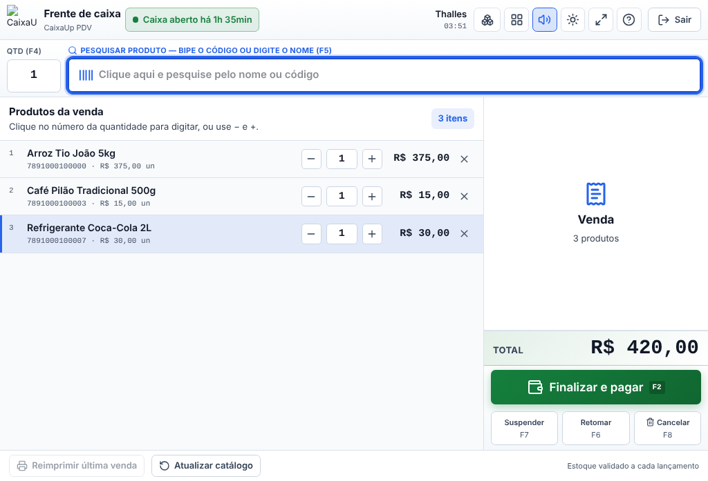
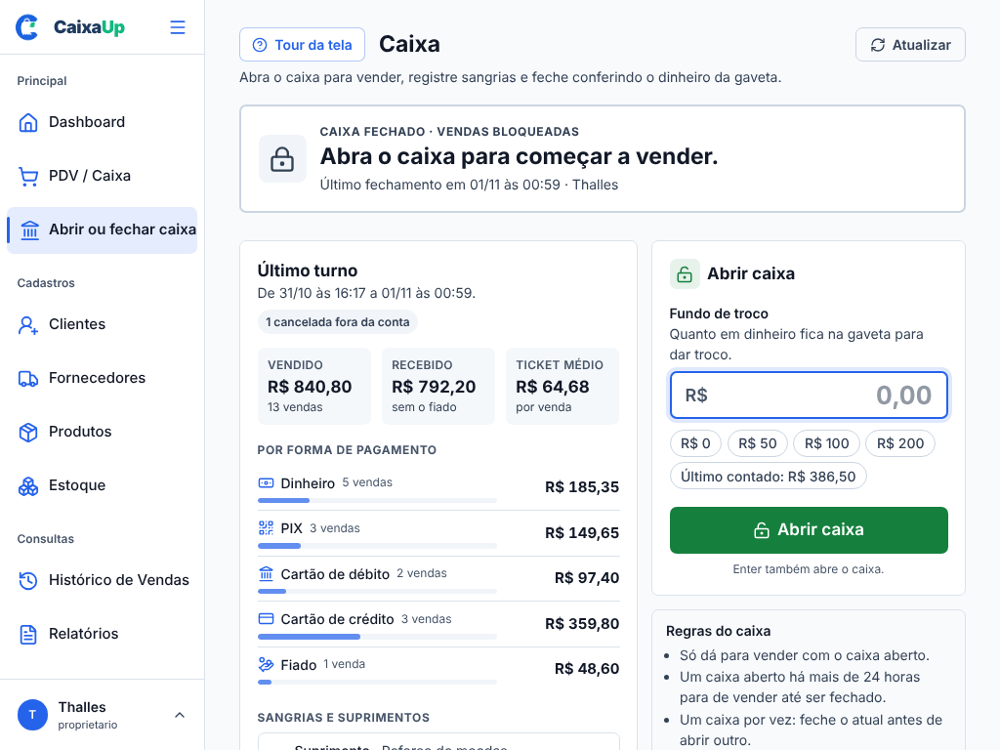
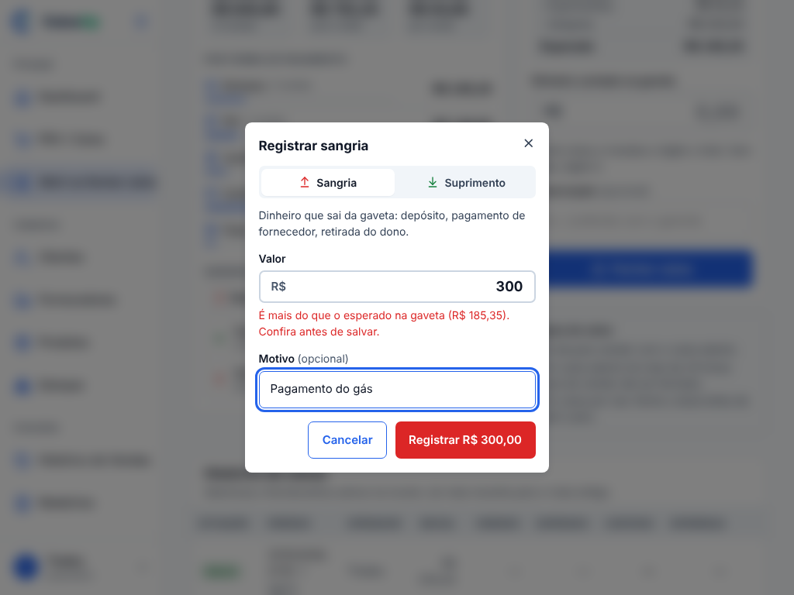
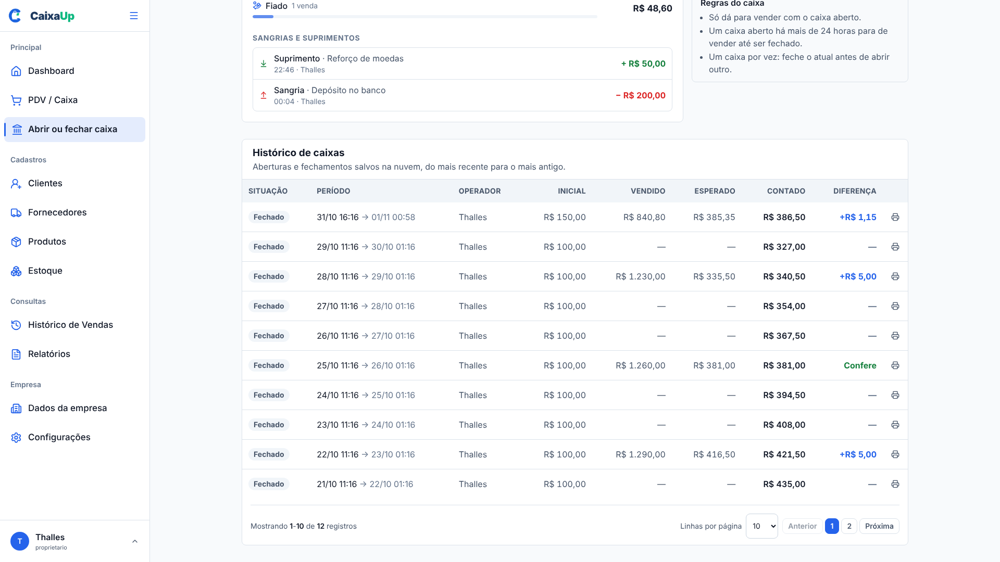

# CaixaUp


-47848f)


CaixaUp é um PDV (ponto de venda) para Windows, feito para a frente de caixa de pequenos comércios: venda rápida pelo teclado, abertura e fechamento de caixa com conferência, cadastros e relatórios.

O programa é instalado no computador do caixa, mas os dados ficam na nuvem (Supabase/PostgreSQL), sem banco local. Novas versões chegam sozinhas pela atualização automática.

Download do instalador: [Releases](https://github.com/thalleseduardo1450-bot/CaixaUp/releases/latest)

## Sumário

- [Status do Projeto](#status-do-projeto)
- [Stack](#stack)
- [Funcionalidades](#funcionalidades)
- [Atalhos do Caixa](#atalhos-do-caixa)
- [Screenshots](#screenshots)
- [Estrutura](#estrutura)
- [Quick Start](#quick-start)
- [Variáveis de Ambiente](#variáveis-de-ambiente)
- [Scripts](#scripts)
- [Publicação e Atualização Automática](#publicação-e-atualização-automática)
- [Dados e Segurança](#dados-e-segurança)
- [Módulos em Desenvolvimento](#módulos-em-desenvolvimento)
- [Roadmap](#roadmap)
- [Contribuindo](#contribuindo)
- [Licença](#licença)
- [Autor](#autor)

## Status do Projeto

A linha 4.x está em uso. A última versão publicada é a **4.0.13**. O histórico de mudanças fica em [CHANGELOG.md](./CHANGELOG.md).

| Área                          | Status                                         |
| ----------------------------- | ---------------------------------------------- |
| Frente de caixa (PDV)         | Em uso                                         |
| Abrir/fechar caixa, sangria   | Em uso                                         |
| Banco de dados                | Supabase (PostgreSQL na nuvem, com RLS)        |
| Login                         | Supabase Auth (e-mail e senha)                 |
| App desktop                   | Electron 33, instalador NSIS para Windows x64  |
| Migração para Tauri (Rust)    | Em andamento, em teste                         |
| Atualização automática        | Em uso, via GitHub Releases                    |
| Assinatura de código          | Pendente (o Windows pode mostrar o SmartScreen)|
| Fiscal NFC-e / NF-e           | Em desenvolvimento                             |
| Pagamentos integrados (TEF)   | Em desenvolvimento                             |
| Linha 3.3.x                   | Descontinuada                                  |

## Stack

**Frontend** (`FRONTEND/`)

- React 19
- TypeScript
- Vite
- Tailwind CSS
- React Router
- Lucide React
- Recharts
- `@supabase/supabase-js`

**Desktop** (`DESKTOP/`)

- Electron 33
- electron-builder (instalador NSIS)
- electron-updater (atualização automática)
- Tauri 2 + Rust em migração

**Backend**

- Supabase: PostgreSQL, Auth e API automática
- Row Level Security por empresa
- Migrações SQL em `FRONTEND/supabase/migrations`

## Funcionalidades

- Frente de caixa rápida pelo teclado, com busca em todos os produtos (sem o limite de 1.000 do Supabase).
- Quantidade editável no carrinho, valor recebido em reais e cálculo de troco.
- Abertura e fechamento de caixa com conferência: valor esperado, valor contado e diferença.
- Sangria e suprimento registrados no caixa.
- Histórico de caixas com impressão do fechamento.
- Caixa aberto há mais de 24 horas mostra aviso e continua vendendo.
- Mensagem clara com o motivo quando uma venda não pode ser concluída.
- Cadastro de produtos (com código de barras), clientes e fornecedores.
- Importação de produtos de planilha.
- Histórico de vendas e relatórios.
- Minha empresa, usuários, perfil e configurações.
- Modo compacto para telas pequenas (1024 × 768, 1366 × 768), com a mesma arrumação do Full HD e letra nítida.
- Janela sem a barra do Windows, com botões próprios de minimizar, maximizar e fechar.
- Abertura animada com o logo do CaixaUp.
- Atualização automática: o programa procura versão nova ao abrir, a cada 30 minutos e ao voltar para a janela.
- Temas claro e escuro.

## Atalhos do Caixa

| Tecla        | Ação                                                        |
| ------------ | ----------------------------------------------------------- |
| `F2`         | Finalizar a venda (mostra "Falta R$" se o valor não cobre)  |
| `F9`         | Finalizar a venda (atalho antigo, continua funcionando)     |
| `F4`         | Alterar a quantidade                                        |
| `F5`         | Buscar produto                                              |
| `Enter`      | 1º mostra o troco, 2º conclui a venda, 3º abre a próxima    |

## Screenshots

<table>
  <tr>
    <td width="50%">
      <strong>Caixa em 1024 × 768 (modo compacto)</strong><br />
      
    </td>
    <td width="50%">
      <strong>Abrir caixa</strong><br />
      
    </td>
  </tr>
  <tr>
    <td width="50%">
      <strong>Fechar caixa com conferência</strong><br />
      
    </td>
    <td width="50%">
      <strong>Sangria e suprimento</strong><br />
      
    </td>
  </tr>
  <tr>
    <td colspan="2">
      <strong>Histórico de caixas</strong><br />
      
    </td>
  </tr>
</table>

## Estrutura

```text
CaixaUp/
├── .github/workflows/
│   ├── release.yml        # gera e publica o instalador do Windows
│   └── pages.yml          # publica a pasta docs/ no GitHub Pages
├── DESKTOP/               # app Electron (main.js, preload.js, splash.html, ícones)
├── FRONTEND/              # telas em React + Vite
│   ├── src/
│   │   ├── pages/         # telas (Admin, Auth)
│   │   ├── components/    # PDV, caixa, cadastros, atualização...
│   │   ├── lib/           # cliente do Supabase
│   │   └── services/      # acesso aos dados
│   └── supabase/migrations/
├── docs/                  # guia do Supabase, imagens e página do projeto
├── CHANGELOG.md
├── LICENSE
└── README.md
```

## Quick Start

### Requisitos

- Node.js 22 (o mesmo usado na publicação)
- npm 10+
- Windows para gerar o instalador
- Um projeto no Supabase (veja [docs/caixaup-supabase-guia.md](./docs/caixaup-supabase-guia.md))

### 1. Clonar o projeto

```bash
git clone https://github.com/thalleseduardo1450-bot/CaixaUp.git
cd CaixaUp
```

### 2. Configurar o frontend

```bash
cd FRONTEND
cp .env.example .env
# preencha VITE_SUPABASE_URL e VITE_SUPABASE_PUBLISHABLE_KEY
npm install
```

### 3. Rodar no navegador

```bash
cd FRONTEND
npm run dev
```

URL local padrão: `http://localhost:5173`

### 4. Rodar como programa (Electron)

```bash
cd FRONTEND
npm run build:desktop

cd ../DESKTOP
npm install
npm start
```

Fora do instalador, o Electron carrega as telas de `FRONTEND/dist`.

## Variáveis de Ambiente

O frontend lê um arquivo `.env` em `FRONTEND/`. Ele não vai para o Git.

```env
VITE_SUPABASE_URL=https://SEU-PROJETO.supabase.co
VITE_SUPABASE_PUBLISHABLE_KEY=sb_publishable_...

# opcionais
VITE_API_URL_VIACEP=
VITE_API_URL_OPENCEP=
VITE_API_URL_BRASILAPI=
VITE_RECAPTCHA_SITE_KEY=
VITE_LOGIN_ALIAS=
VITE_LOGIN_EMAIL=
```

Use só a chave **publicável** do Supabase no app. A chave `service_role` nunca vai para o frontend nem para o repositório: quem protege os dados é o RLS.

## Scripts

### Frontend

```bash
cd FRONTEND
npm run dev            # servidor local Vite
npm run lint           # ESLint
npm run build          # build de produção
npm run build:desktop  # build usado pelo programa (Electron)
npm run preview        # prévia do build
```

### Desktop

```bash
cd DESKTOP
npm start              # abre o programa com o Electron
npm run dist           # gera o instalador CaixaUp-Setup-X.Y.Z.exe em DESKTOP/release
```

## Publicação e Atualização Automática

A publicação é automática pelo GitHub Actions (`.github/workflows/release.yml`):

1. Suba a versão em `DESKTOP/package.json` (por exemplo, `4.0.13` → `4.0.14`) e registre as novidades no `CHANGELOG.md`.
2. Envie para `main`, `release/**` ou `claude/**`.
3. O GitHub gera o `CaixaUp-Setup-X.Y.Z.exe` no Windows e publica o release `vX.Y.Z` com `latest.yml` e `.blockmap`.
4. Os computadores com o CaixaUp instalado baixam a versão nova sozinhos.

Um release já publicado não é refeito. Para corrigir, publique uma versão nova.

> Atenção: qualquer mudança na versão de `DESKTOP/package.json` nesses ramos publica uma versão para todos os caixas.

## Dados e Segurança

- Todos os dados ficam no Supabase (PostgreSQL). Não há banco local.
- Cada empresa só enxerga os próprios dados, pelas regras de RLS do banco.
- Login e recuperação de senha pelo Supabase Auth.
- Tabelas do caixa: `sessoes_caixa` (com `valor_esperado` e `diferenca`) e `movimentacoes_caixa` (sangria e suprimento).
- O esquema completo está em `FRONTEND/supabase/migrations`.
- Segredos (chaves privadas, `service_role`, chave de assinatura de atualização) ficam nos *Secrets* do GitHub, nunca no código.

## Módulos em Desenvolvimento

Estas áreas aparecem no menu, mas ainda não devem ser usadas em operação real:

- Fiscal NFC-e / NF-e.
- Pagamentos integrados (TEF).
- Estoque avançado, compras, trocas/devoluções, CRM/fidelidade e omnichannel.

## Roadmap

- Concluir a migração para Tauri (Rust): instalador menor e abertura mais rápida.
- Assinar o instalador para o Windows não mostrar o aviso do SmartScreen.
- Emissão de NFC-e.
- Integração com TEF e Pix.
- Testes automatizados com Supabase.
- Relatórios de caixa e vendas mais completos.

## Contribuindo

Fluxo sugerido:

```bash
git checkout -b feature/minha-melhoria
npm --prefix FRONTEND run lint
npm --prefix FRONTEND run build
```

Antes de abrir um pull request:

- Explique o problema resolvido.
- Informe como testou a mudança.
- Não mude a versão em `DESKTOP/package.json` sem combinar: isso publica o instalador.
- Não inclua chaves ou senhas.

## Licença

Este projeto está sob licença MIT. Consulte [LICENSE](./LICENSE).

O CaixaUp nasceu de uma base do [Hórus PDV](https://github.com/flaviooliveira-code/horus_pdv), também MIT; o aviso de copyright original continua no arquivo LICENSE.

## Autor

Mantido por **Thalles**.

- GitHub: <https://github.com/CaixaUP>
